<p><picture><source media="(max-width: 600px)" srcset="assets/readme/hero-mobile.svg"/>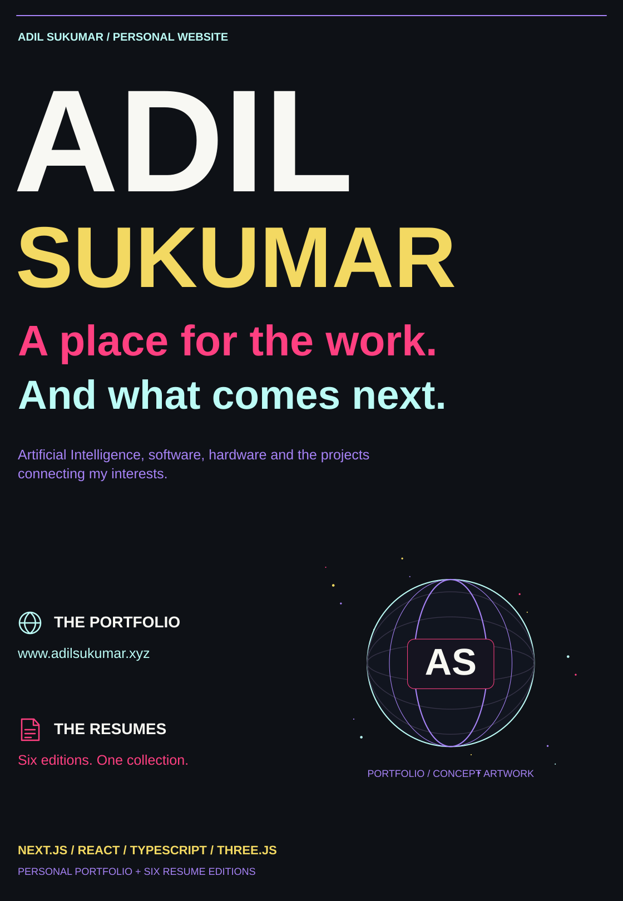</picture></p>

<p align="center"><a href="#the-site-i-wanted-to-build">Overview</a> · <a href="#explore-the-experience">Experience</a> · <a href="#motion-and-rendering">Motion</a> · <a href="#run-locally">Setup</a> · <a href="#two-sites-one-repository">Resumes</a> · <a href="#edit-the-source">Source</a></p>

<p><picture><source media="(max-width: 600px)" srcset="assets/readme/section-overview-mobile.svg"/>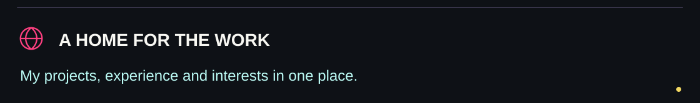</picture></p>

## The site I wanted to build

This is the source for **my personal website**: a place to bring together my work in **Artificial Intelligence**, software and hardware, alongside experience, certifications, projects and ways to reach me.

I wanted the portfolio to feel like something you explore. It opens with a globe-led sequence, moves into my name and a scroll-driven portrait, then settles into the work. The repository also contains a separate, portfolio-matched site for six resume editions.

[Visit my portfolio](https://www.adilsukumar.xyz) · [Browse my resumes](https://www.resume.adilsukumar.xyz) · [GitHub](https://github.com/adilsukumar) · [LinkedIn](https://www.linkedin.com/in/adilsukumar)


<p><picture><source media="(max-width: 600px)" srcset="assets/readme/section-experience-mobile.svg"/>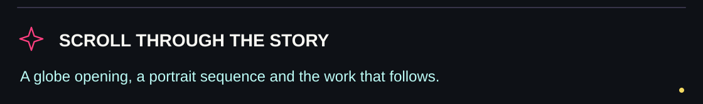</picture></p>

## Explore the experience

| Part of the site | Implementation |
|---|---|
| Opening journey | `PopulationJourney` coordinates the globe, vortex and opening scroll sequence |
| Name reveal | `Hero` combines scroll-linked text with the glitter/particle background |
| Portrait | `PortraitReveal` scrubs a canvas through the local portrait frames |
| Experience | Career and project experience section |
| Certifications | Certification collection |
| Projects | The portfolio's project data, cards, links and animated transitions |
| Contact | Email, GitHub and LinkedIn links, plus the navigation contact modal |
| Shared atmosphere | Starfield, ambient glows, custom cursor, section dividers and optional sound |

The top-level composition lives in [`src/app/page.tsx`](src/app/page.tsx). This is the website repository; the [GitHub profile README](https://github.com/adilsukumar/AdilSukumar) is maintained separately.


<p><picture><source media="(max-width: 600px)" srcset="assets/readme/section-motion-mobile.svg"/>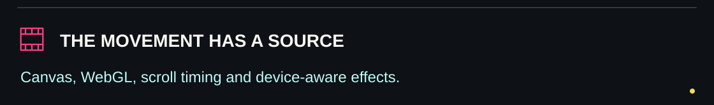</picture></p>

## Motion and rendering

The site uses **Framer Motion**, **Three.js**, canvas and CSS for different layers of the experience.

- **Portrait:** 69 local WebP frames under `public/portrait-sequence/`. The renderer blends adjacent frames and sizes its backing canvas for the selected quality tier.
- **Globe:** a custom component using geographic paths from `d3-geo`; its land data is fetched from a Natural Earth GeoJSON source.
- **Device-aware effects:** a shared probe checks hardware hints, data-saving/reduced-motion preferences and sampled frame timing. Components use the result to lower visual complexity, frame rates or rendering scale.
- **Sound:** an optional user-operated button controls an embedded YouTube player. It starts disabled and depends on the player being available.
- **Typography:** Geist and Geist Mono are configured through `next/font/google`; Next.js handles optimization and self-hosting of the resulting font assets.

The README's SVG illustrations are separate documentation artwork. The 69 portrait frames and all website effects stay unchanged by this README update.


<p><picture><source media="(max-width: 600px)" srcset="assets/readme/section-setup-mobile.svg"/>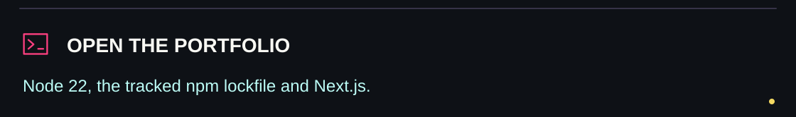</picture></p>

## Run locally

Use **Node.js 22**, matching `.nvmrc`, and npm. The repository tracks `package-lock.json`.

```bash
git clone https://github.com/adilsukumar/Personal-Website.git
cd Personal-Website
npm ci
npm run dev
```

Open **http://localhost:3000**. Edit **`src/app/page.tsx`** to change the page composition; edit the individual components for their content and behavior.

| Command | Purpose |
|---|---|
| `npm run dev` | Next.js development server |
| `npm run build` | Production build |
| `npm start` | Serve the production build |
| `npm run lint` | ESLint |

The current manifest uses **Next.js 16.2.12**, **React 19.2.4**, **TypeScript**, **Tailwind CSS 4**, Framer Motion, Three.js, `d3-geo` and Lucide icons. No test script is declared.

The main portfolio uses the Next.js App Router. On Vercel, deploy the repository root with the Next.js framework preset. It has not been configured as a static export. Google-font retrieval may require network access during the build; the globe dataset and optional YouTube embed are separate runtime network dependencies.


<p><picture><source media="(max-width: 600px)" srcset="assets/readme/section-sites-mobile.svg"/>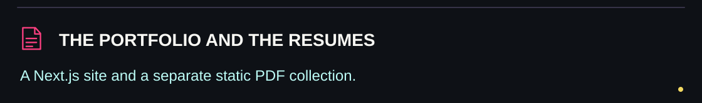</picture></p>

## Two sites, one repository

<p><picture><source media="(max-width: 600px)" srcset="assets/readme/sites-mobile.svg"/>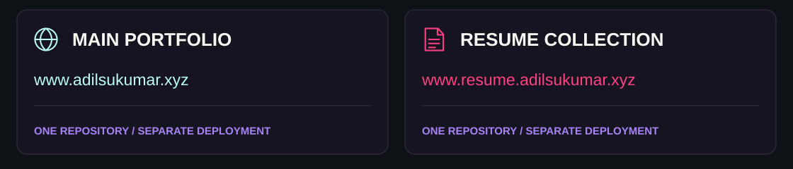</picture></p>

| | Main portfolio | Resume collection |
|---|---|---|
| Live | [www.adilsukumar.xyz](https://www.adilsukumar.xyz) | [www.resume.adilsukumar.xyz](https://www.resume.adilsukumar.xyz) |
| Source root | Repository root | `resume-site/` |
| Runtime | Next.js | Static HTML, CSS, JavaScript and PDFs |
| Vercel preset | Next.js | Other |
| Output | Next.js-managed build | `public/` |

### Six resume editions

| Edition | Pages | File |
|---|---:|---|
| General | 1 | [PDF](resume-site/public/resumes/adil-sukumar-general-intmtech.pdf) |
| Technology | 1 | [PDF](resume-site/public/resumes/adil-sukumar-tech-intmtech.pdf) |
| Banking & Fintech | 1 | [PDF](resume-site/public/resumes/adil-sukumar-banking-intmtech.pdf) |
| Bioinformatics | 1 | [PDF](resume-site/public/resumes/adil-sukumar-bio-intmtech.pdf) |
| Research | 1 | [PDF](resume-site/public/resumes/adil-sukumar-research-intmtech.pdf) |
| Full CV | 6 | [PDF](resume-site/public/resumes/adil-sukumar-full-intmtech.pdf) |

The collection contains the approved **Integrated M.Tech.** PDFs. Their page counts and SHA-256 hashes are recorded in [`resume-site/resume-manifest.json`](resume-site/resume-manifest.json). The full editable site and PDF-update instructions are in [`resume-site/README.md`](resume-site/README.md).

To preview that static site independently:

```bash
cd resume-site
python -m http.server 8766 --bind 127.0.0.1 --directory public
```

Open **http://127.0.0.1:8766**. In its Vercel project, set the root directory to `resume-site`, choose **Other**, leave build/install commands empty and use output directory `public`. Its hosting configuration is in `resume-site/vercel.json`.

### Resume Observatory

The collection pairs six direct PDF tiles with a floating document stack. Hovering or keyboard-focusing a tile switches the actual first-page WebP preview, title, accent and open-PDF links. Orbital rings and pointer-responsive paper tilt connect it visually to the portfolio. On compact screens the decorative preview stage is hidden and the PDF tiles remain available. Direct PDF access works without JavaScript; reduced-motion and low-power modes reduce decorative motion.

| Resume-site change | Source |
|---|---|
| Page structure | [template.html](resume-site/template.html) |
| Card descriptions, PDF checks and preview generation | [build.py](resume-site/build.py) |
| Published page | [public/index.html](resume-site/public/index.html) |
| Hover/focus selection and paper tilt | [theme.js](resume-site/public/theme.js) |
| Responsive layout and orbital styling | [style.css](resume-site/public/style.css) |
| Generated first-page images | [public/previews/](resume-site/public/previews/) |

The PDF builder is a separate maintenance operation. Install `resume-site/requirements.txt` for its `pypdf`, `pypdfium2` and Pillow dependencies. It reads a local resume source directory (or `RESUME_SOURCE`), checks degree wording/page counts, refreshes the PDFs, renders first-page previews when needed, and regenerates `public/index.html` from `template.html`. After manually replacing a PDF, regenerate its preview and manifest before publishing. Running either published site does not require running the builder.


<p><picture><source media="(max-width: 600px)" srcset="assets/readme/section-source-mobile.svg"/>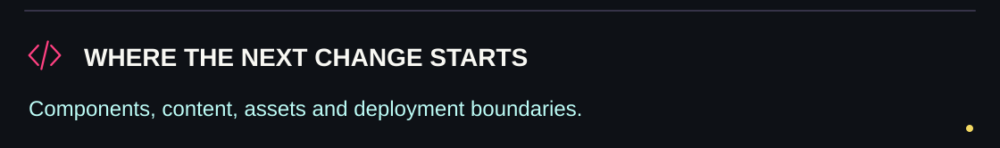</picture></p>

## Edit the source

<p align="center"><a href="src/app/page.tsx">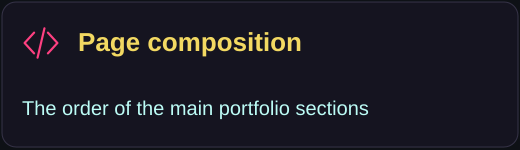</a> <a href="src/components/PortraitReveal.tsx">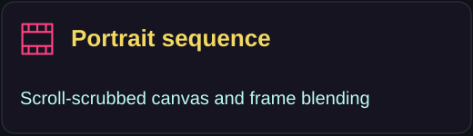</a> <a href="src/components/Projects.tsx">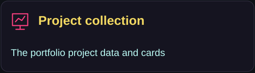</a> <a href="resume-site/README.md">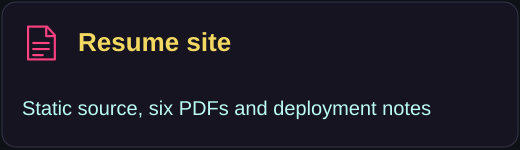</a></p>

| Change | Start here |
|---|---|
| Page order | [src/app/page.tsx](src/app/page.tsx) |
| Site metadata, fonts and shared wrappers | [src/app/layout.tsx](src/app/layout.tsx) |
| Main visual theme | [src/app/globals.css](src/app/globals.css) |
| Hero copy and reveal | [Hero.tsx](src/components/Hero.tsx) |
| Opening globe/journey | [PopulationJourney.tsx](src/components/PopulationJourney.tsx) · [Globe.tsx](src/components/Globe.tsx) |
| Portrait rendering | [PortraitReveal.tsx](src/components/PortraitReveal.tsx) · [portrait frames](public/portrait-sequence/) |
| Experience, certifications and projects | [Experience.tsx](src/components/Experience.tsx) · [Certifications.tsx](src/components/Certifications.tsx) · [Projects.tsx](src/components/Projects.tsx) |
| Contact links | [Contact.tsx](src/components/Contact.tsx) · [ContactModal.tsx](src/components/ContactModal.tsx) |
| Visual quality probe | [useIsLowPowerDevice.ts](src/lib/useIsLowPowerDevice.ts) |
| Resume site and public PDFs | [resume-site/](resume-site/) |

### Framework references

This project began with `create-next-app`. For framework work, use the version-specific guidance recorded in [`AGENTS.md`](AGENTS.md) and the installed `node_modules/next/dist/docs/` guides. Additional references: [Next.js documentation](https://nextjs.org/docs), [Learn Next.js](https://nextjs.org/learn), [Next.js source](https://github.com/vercel/next.js) and [deployment documentation](https://nextjs.org/docs/app/building-your-application/deploying).

**Built and maintained by Adil Sukumar.**


<p><picture><source media="(max-width: 600px)" srcset="assets/readme/closing-mobile.svg"/>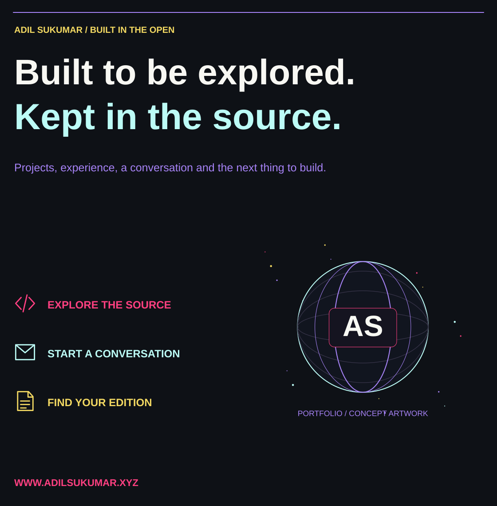</picture></p>
